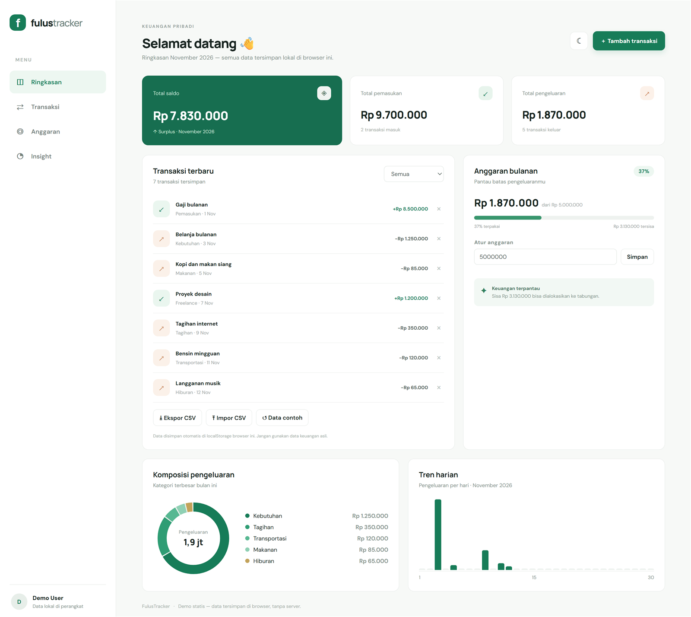

# FulusTracker

Aplikasi pencatat keuangan pribadi untuk membantu kamu memahami pemasukan, pengeluaran, dan anggaran bulanan.

> **Status:** demo publik. Data tersimpan di browser (localStorage), tanpa server dan tanpa akun.

**Demo langsung:** https://chlayverts.github.io/FulusTracker/

## Preview dashboard



Screenshot di atas menggunakan data contoh dan hanya untuk pratinjau.

## Fitur

- **Ringkasan** saldo, pemasukan, dan pengeluaran bulan berjalan.
- **Catat transaksi** pemasukan atau pengeluaran dengan kategori dan tanggal.
- **Anggaran bulanan** yang bisa diatur, lengkap dengan indikator sisa dan peringatan saat terlampaui.
- **Komposisi pengeluaran** per kategori dalam bentuk donut chart.
- **Tren harian** pengeluaran sepanjang bulan.
- **Ekspor dan impor CSV** untuk mencadangkan atau memindahkan data.
- **Mode gelap** yang mengikuti preferensi sistem dan bisa diganti manual.
- **Tersimpan otomatis** di perangkat, tetap ada setelah halaman ditutup.
- Tampilan responsif untuk desktop dan ponsel.

## Teknologi

- Next.js 16 (App Router) dengan **static export** — tidak butuh server saat dijalankan.
- React 19 + TypeScript (strict).
- CSS tanpa framework, chart digambar sebagai SVG (tanpa library chart).
- Vitest untuk pengujian logika keuangan.
- GitHub Actions: CI (lint, typecheck, test, build) dan deploy otomatis ke GitHub Pages.

## Menjalankan di komputer

### 1. Pasang kebutuhan

Install [Node.js versi LTS](https://nodejs.org/) dan Git.

### 2. Clone repository

```bash
git clone https://github.com/chlayverts/FulusTracker.git
cd FulusTracker
```

### 3. Install dependency dan jalankan

```bash
npm ci
npm run dev
```

Buka [http://localhost:3000](http://localhost:3000).

## Perintah yang tersedia

```bash
npm run dev        # jalankan server pengembangan
npm run build      # buat build statis ke folder out/
npm run preview    # sajikan hasil build statis secara lokal
npm run lint       # periksa kualitas kode
npm run typecheck  # periksa tipe TypeScript
npm test           # jalankan unit test
```

## Struktur singkat

| Path | Isi |
| --- | --- |
| `app/` | Halaman, layout, dan stylesheet |
| `components/` | Chart donut dan tren (SVG, tanpa dependency) |
| `lib/finance.ts` | Perhitungan uang, anggaran, agregasi, dan CSV |
| `lib/storage.ts` | Baca/tulis state dan tema ke localStorage |
| `lib/store.ts` | Store kecil yang dipakai `useSyncExternalStore` |
| `tests/` | Unit test untuk logika di `lib/finance.ts` |

## Catatan data dan keamanan

Data disimpan di localStorage browser dan tidak pernah dikirim ke mana pun. Jangan memasukkan informasi rekening, kata sandi, atau data keuangan sensitif. Autentikasi dan penyimpanan database belum disiapkan.

## Rencana pengembangan

1. Anggaran per kategori, bukan hanya total bulanan.
2. Grafik tren beberapa bulan dan perbandingan bulan sebelumnya.
3. Ekspor laporan bulanan ke PDF.
4. Autentikasi dan database dengan kebijakan akses per pengguna.

## Kontribusi

Silakan buat issue untuk menyampaikan bug atau ide fitur. Perubahan kode dapat diajukan melalui pull request; CI akan menjalankan lint, typecheck, test, dan build secara otomatis.
